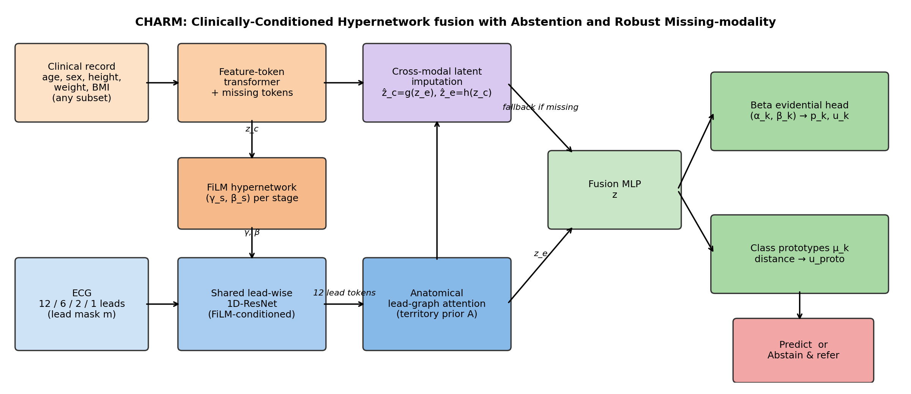

# CHARM

**Clinically conditioned deep learning for robust cardiovascular disease diagnosis from incomplete electrocardiogram and patient data**

[](https://github.com/iitrky/CHARM/actions/workflows/tests.yml)
[](https://colab.research.google.com/github/iitrky/CHARM/blob/main/notebooks/CHARM_Colab.ipynb)
[](LICENSE)

Official implementation of CHARM (Clinically conditioned Hypernetwork fusion with Abstention and Robust Missing modality handling), G. Arul Dalton et al., manuscript under review.



## What CHARM does

CHARM diagnoses five ECG superclasses (NORM, MI, STTC, CD, HYP) from a 12-lead ECG and patient clinical variables, and stays valid when inputs are missing:

- **Missingness-aware clinical conditioning.** A feature-token transformer with learned missing tokens encodes any subset of clinical variables; a hypernetwork turns this into bounded FiLM parameters for every stage of a lead-wise 1D-ResNet.
- **Anatomical lead-graph attention.** Lead tokens are aggregated with a coronary-territory prior; any subset of leads (12, 6, 3, 2 or 1) is accepted.
- **Cross-modal latent imputation.** A missing ECG or clinical record is replaced by an embedding predicted from the other modality, trained with a teacher–student consistency loss.
- **Risk-controlled abstention.** Beta-evidential and prototype-distance uncertainty are combined into one score; a validation-set threshold keeps selective risk below a target (default 5%).

## Repository layout

| File | Purpose |
|---|---|
| `charm_model.py` | CHARM model and losses |
| `charm_data.py` | PTB-XL loading; lead, feature and modality masking |
| `train_charm.py` | Training, robustness evaluation, abstention threshold, ablation flags |
| `baselines.py` | XResNet1d, InceptionTime, CNN-LSTM-Attention, Transformer, FT-Transformer, early/late fusion, MedFuse-style, DA-GAT-v2-style, HyperFusion-style, MC-dropout, temperature scaling |
| `external_eval.py` | Chapman–Shaoxing and CPSC-2018 validation without fine-tuning |
| `aggregate.py` | Mean ± std tables, deep ensemble, DeLong test, bootstrap CI |
| `figures.py` | Risk–coverage, territory attribution, FiLM importance, counterfactual age |
| `metrics_utils.py` | AUROC, F1, ECE, AURC, selective-risk threshold |
| `run_all.sh` | Every experiment in the paper |
| `notebooks/CHARM_Colab.ipynb` | Resumable Google Colab pipeline |
| `tests/` | Unit tests for metrics and statistics |

## Installation

```bash
git clone https://github.com/iitrky/CHARM.git
cd CHARM
pip install -r requirements.txt
```

## Data

All datasets are public on PhysioNet:
- [PTB-XL v1.0.3](https://physionet.org/content/ptb-xl/1.0.3/) — training, validation (fold 9) and test (fold 10)
- [PhysioNet/CinC Challenge 2020](https://physionet.org/content/challenge-2020/1.0.2/) — `chapman_shaoxing` and `cpsc_2018` for external validation

## Quick start

```bash
# 1-minute smoke test on synthetic data
python train_charm.py --synthetic

# Train CHARM on PTB-XL (one seed)
python train_charm.py --root /data/ptb-xl-1.0.3 --seed 0

# One baseline
python baselines.py --root /data/ptb-xl-1.0.3 --model dagat --seed 0

# Everything in the paper (5 seeds, baselines, ablations, external validation, tables, figures)
bash run_all.sh /data/ptb-xl-1.0.3 /data/chapman_shaoxing /data/cpsc_2018
```

Results appear in `results/`; `results/ALL_TABLES.md` contains every table in manuscript order.

## Ablations

| Flag | Removes |
|---|---|
| `--no_film` | Clinical conditioning (becomes late concatenation) |
| `--static_film` | Hypernetwork (FiLM parameters no longer depend on the patient) |
| `--no_prior` | Anatomical lead-graph prior |
| `--lam_imp 0` | Cross-modal imputation loss |
| `--lam_cons 0` | Teacher–student consistency loss |
| `--omega 1 --lam_proto 0` | Prototype uncertainty |
| `--bce_loss` | Evidential loss (plain BCE) |
| `--no_aug` | Lead, feature and modality masking during training |

## Tests

```bash
pytest -q tests
```

## Citation

```bibtex
@article{dalton2026charm,
  title   = {Clinically conditioned deep learning for robust cardiovascular disease diagnosis from incomplete electrocardiogram and patient data},
  author  = {Dalton, G. Arul},
  journal = {Under review},
  year    = {2026}
}
```

## Contact

Dr G. Arul Dalton, Department of Computer Science and Engineering, Saveetha Engineering College, Chennai, India — aruldalton@saveetha.ac.in — ORCID [0000-0002-5981-7176](https://orcid.org/0000-0002-5981-7176)

## License

MIT — see [LICENSE](LICENSE).
